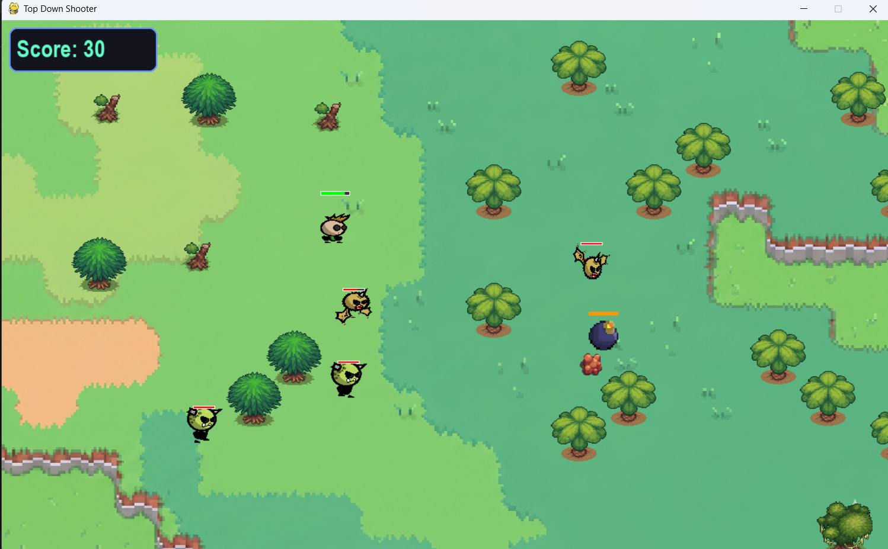
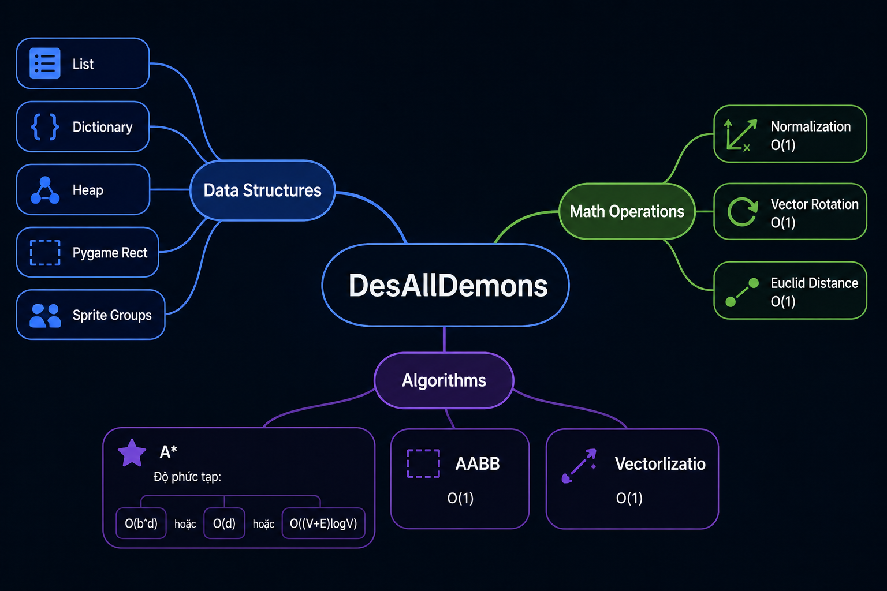

# DesAllDemons

## 1. Tên và mô tả

**DesAllDemons** *(Top Down Shooter — Battle for Survival)* là một tựa game bắn súng sinh tồn 2D góc nhìn từ trên xuống (Top-Down Shooter) được xây dựng bằng **Python** và **Pygame** trong khuôn khổ đồ án Cấu trúc dữ liệu & Giải thuật (DSA).

Người chơi vào vai anh hùng chiến đấu chống lại các đợt quái vật liên tục truy đuổi qua bản đồ có chướng ngại vật (cây cối, tinh thể đá), sử dụng linh hoạt 3 loại vũ khí, tận dụng bom nổ trên bản đồ và thu thập cầu máu để sống sót và đạt điểm số cao nhất.

---

## 2. Tính năng

- **Điều khiển linh hoạt:** Di chuyển 8 hướng bằng bàn phím (`WASD`), tự động chạy tới vị trí chỉ định bằng chuột phải (hiển thị điểm đánh dấu mục tiêu) và dịch chuyển tức thời (`Space`).
- **Hệ thống 3 loại vũ khí:**
  - **Pistol (`1`):** Bắn đạn đơn chính xác, tầm xa (hồi chiêu `250 ms`).
  - **Shotgun (`2`):** Bắn chùm 7 viên theo hình quạt 90°, sát thương diện rộng ở cự ly gần (hồi chiêu `750 ms`).
  - **Machine Gun (`3`):** Bắn liên thanh tốc độ cao kèm độ giật nòng tự nhiên (hồi chiêu `150 ms`).
- **AI kẻ địch tìm đường thông minh:** Hai loại quái vật (`MonsterType1` bay 3 HP và `MonsterType2` bộ binh 5 HP) truy đuổi người chơi, tự động né chướng ngại vật bằng **A\*** kết hợp **Flow Field (Reverse Dijkstra)**, kiểm tra tầm nhìn thẳng (**Line-of-Sight**) và lực đẩy tách đàn (**Separation Force**).
- **Vật phẩm & Tương tác môi trường:**
  - **Bomb:** Chịu tối đa 4 phát bắn rồi phát nổ gây sát thương diện rộng (5 sát thương trong bán kính `70 px`) kèm hiệu ứng nổ và 40 mảnh hạt lửa.
  - **Health Orb:** Rơi ngẫu nhiên khi tiêu diệt quái hoặc kích nổ bom, hồi `+1 HP` khi nhặt.
- **Bảng xếp hạng Top 10 (High Scores):** Tự động lưu trữ và hiển thị 10 thành tích cao nhất vào `highscores.json`, hỗ trợ nhập tên người chơi ngay khi phá kỷ lục.
- **Tối ưu hiệu năng 60 FPS ổn định:** Áp dụng **Spatial Hash Grid** (`O(1)` cho va chạm và tách đàn), **Object Pooling** cho đạn và hiệu ứng hạt, **Asset/Font Caching**, **Pre-baked Map Layer** và **Frustum/Camera Culling**.

---

## 3. Ảnh demo

### Giao diện gameplay


### Sơ đồ cấu trúc dự án


---

## 4. Hướng dẫn cài đặt

### Yêu cầu hệ thống
- **Python 3.12** trở lên
- Thư viện **Pygame** (`pygame >= 2.5`)

### Các bước cài đặt
1. **Clone kho lưu trữ:**
   ```bash
   git clone https://github.com/maivanlongnhat/DSA-project.git
   cd DSA-project
   ```

2. **(Khuyến nghị) Tạo và kích hoạt môi trường ảo:**
   ```bash
   python -m venv .venv
   # Trên Windows (PowerShell):
   .venv\Scripts\Activate.ps1
   # Trên macOS / Linux:
   source .venv/bin/activate
   ```

3. **Cài đặt thư viện Pygame:**
   ```bash
   pip install pygame
   ```

---

## 5. Cách sử dụng

Khởi chạy trò chơi từ thư mục gốc `DSA-project/`:
```bash
python DesAllDemons/main.py
```

### Bảng điều khiển

| Phím / Chuột | Chức năng |
| :--- | :--- |
| `W` `A` `S` `D` | Di chuyển nhân vật theo 8 hướng |
| **Chuột phải** | Đặt điểm đích để nhân vật tự động di chuyển tới |
| **Chuột trái** | Ngắm và bắn vũ khí theo hướng con trỏ chuột |
| `1` / `2` / `3` | Đổi vũ khí (`1`: Pistol, `2`: Shotgun, `3`: Machine Gun) |
| `Space` | Dịch chuyển tức thời tới vị trí con trỏ chuột |
| `ESC` | Thoát màn chơi hiện tại / quay lại menu |

### Luật chơi cơ bản
- Tiêu diệt mỗi quái vật bằng súng cộng **+10 điểm**.
- Bắn vỡ các quả **Bomb** rải rác trên bản đồ để tiêu diệt nhiều quái vật cùng lúc trong phạm vi vụ nổ.
- Nhặt **Health Orb** khi mất máu để duy trì sinh tồn; nếu điểm số lọt Top 10 sau khi hết máu, nhập tên và nhấn `Enter` để lưu vào bảng xếp hạng.

---

## 6. Công nghệ dùng

- **Ngôn ngữ lập trình:** Python 3.12+
- **Thư viện đồ họa & game loop:** Pygame 2.6+ (SDL2)
- **Thuật toán & Cấu trúc dữ liệu:**
  - **A\* Search** (`heapq`, đồ thị kề tiền tính, mảng phẳng 1D dùng generation counter, Octile Heuristic)
  - **Flow Field (Reverse Dijkstra)** chia sẻ lộ trình cho nhiều kẻ địch
  - **Supercover Bresenham Raycast** kiểm tra tầm nhìn thẳng (Line-of-Sight)
  - **Spatial Hash Grid 2D** tối ưu kiểm tra va chạm và tách đàn
  - **Object Pooling** tái sử dụng `Projectile` & `Particle`
  - **Frustum Culling & Static Layer Baking** tối ưu render
- **Lưu trữ dữ liệu:** JSON (`DesAllDemons/highscores.json`)

---

## 7. Tên tác giả

- **Tác giả:** Mai Văn Long Nhật (`maivanlongnhat`)
- **GitHub:** [https://github.com/maivanlongnhat](https://github.com/maivanlongnhat)
- **Email:** `nhat2282k7@gmail.com`
